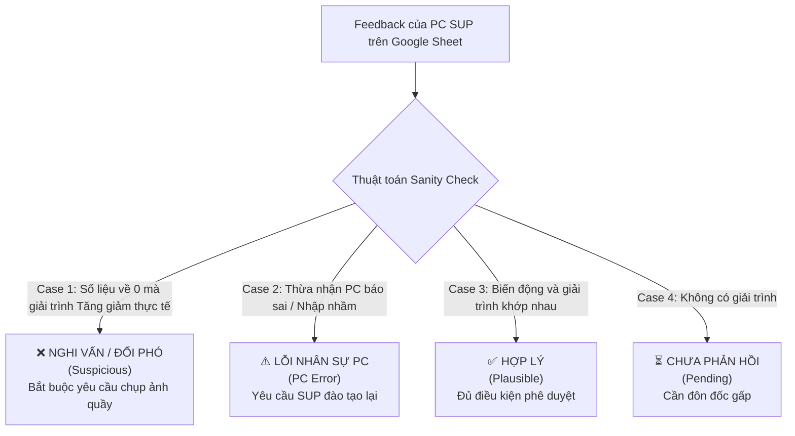

# SOF Audit Evaluation Rules & GTM Action Playbook

## 1. Thuật Toán Nhận Diện Cảnh Báo Bất Thường (3 Priority Flag Rules)

Hệ thống tập trung kiểm soát **3 cờ báo động ưu tiên cao nhất** từ bảng `Check theo CAT, theo Brand`:

```mermaid
flowchart TD
    DATA[Dữ liệu trưng bày 5 tuần liên tiếp\nW37 - W38 - W39 - W40 - W41] --> F1{Cờ 1: WoW Delta >= 2}
    DATA --> F2{Cờ 2: 4W Delta >= 8}
    DATA --> F3{Cờ 3: Data về 0}

    F1 -->|abs(W41 - W40) >= 2| FLAG1[Cảnh báo Lệch >2 so với tuần cũ\nW41 có 7 ca]
    F2 -->|abs(W41 - min(W37..W40)) >= 8| FLAG2[Cảnh báo Lệch >8 so với 4 tuần trước\nW41 có 4 ca]
    F3 -->|W41 = 0 VÀ W40 > 0| FLAG3[Cảnh báo Trắng quầy / Mất SOF\nW41 có 0 ca]
```

### Chi tiết điều kiện toán học:
1. **Flag 1 (`diff_2_prev`):** $|W_{cur} - W_{prev}| \ge 2$. Phát hiện các cú sốc tăng giảm ngắn hạn ngay trong tuần.
2. **Flag 2 (`diff_8_4w`):** $|W_{cur} - \min(W_{prev4})| \ge 8$. Phát hiện các biến động quy mô lớn làm đảo lộn cấu trúc thị phần SOF.
3. **Flag 3 (`zero_drop`):** $W_{cur} = 0 \land W_{prev} > 0$. Báo động đỏ mất hoàn toàn diện tích trưng bày của model/brand tại điểm bán.

---

## 2. Vai Trò Của Chỉ Số `PC Active` (Column D) Trong Thẩm Định GTM

Việc bổ sung trường **`PC active` (Cột D)** mang lại một chiều phân tích sâu sắc cho GTM Channel Strategist:

| Trạng Thái PC | Đặc Điểm Vận Hành Tại Shop | Ý Nghĩa Kiểm Tra & Thẩm Định GTM |
|---|---|---|
| **`PC Active >= 1` (Có PC)** | Có nhân viên bán hàng LG chuyên trách túc trực 6 ngày/tuần tại điểm bán. | **Kỳ vọng độ chính xác tuyệt đối.** Nếu số liệu bị sai hoặc lệch đột biến $\to$ **Lỗi kỷ luật & năng lực kiểm đếm của PC.** Không thể chấp nhận lý do *"không nắm được số liệu"*. |
| **`PC Active = 0` (Không PC)** | Cửa hàng không có promoter trực tiếp; số liệu phụ thuộc vào PG lưu động hoặc đại lý tự khai. | **Nguy cơ điểm mù thông tin.** Nếu số liệu biến động $\to$ Bắt buộc PC Supervisor phải trực tiếp đi thực địa audit và chụp ảnh xác minh, không được duyệt giải trình từ xa. |

---

## 3. Thuật Toán Kiểm Tra Tính Hợp Lý Của Phản Hồi (Sanity / Validity Check)

Không phải mọi phản hồi của PC SUP trên Google Sheet đều đáng tin cậy. Hệ thống áp dụng 3 quy tắc kiểm tra chéo (Cross-validation) giữa **số liệu biến động thực tế** và **văn bản giải trình**:



### Chi tiết các quy tắc Sanity Check:
1. **Rule SAN-01 (Mâu thuẫn rơi về 0):** Nếu $W_{cur} = 0$ và $W_{prev} > 0$ (mất trắng trưng bày), nhưng feedback chỉ ghi `"Shop báo tăng giảm đúng thực tế"` mà không nêu lý do cụ thể (hết hàng, đại lý cắt quầy, hay đổi bục kệ) $\to$ **Gán nhãn: `SUSPICIOUS` (Nghi vấn đối phó / không đi thực tế).**
2. **Rule SAN-02 (Biến động cực đoan không giải trình sâu):** Nếu biến động $|\Delta| \ge 8$ sets nhưng phản hồi chung chung $\to$ **Gán nhãn: `SUSPICIOUS` (Nghi vấn copy-paste hàng loạt).**
3. **Rule SAN-03 (Lỗi nhập liệu lặp lại):** Nếu lý do viện dẫn `"Tuần cũ PC báo sai, tuần này điều chỉnh lại"` $\to$ **Gán nhãn: `PC_ERROR` (Rủi ro kỷ luật & chất lượng kiểm đếm).**
4. **Rule SAN-EXTRA (Nguyên Tắc MECE - Phân Định Rạch Ròi Giữa Nghi Vấn & Extra Note):**
   - **Bản chất quản trị:** Một ca bị đánh dấu `SUSPICIOUS` (Nghi vấn đối phó) KHI VÀ CHỈ KHI có cờ biến động lớn (lệch $>8$ sets hoặc rơi về 0) với giải trình chung chung *"tăng giảm đúng thực tế"* **MÀ CHƯA CÓ GHI CHÚ BỔ SUNG NÀO TỪ SUP** (`extra_note = null`).
   - **Cơ chế chuyển tiếp tự động (Auto-transition):** Ngay khi PC SUP hoặc Regional Manager điền cột `Extra note` trên Google Sheet:
     - Ca này **LẬP TỨC ĐƯỢC RÚT KHỎI BỘ LỌC NGHI VẤN ĐỐI PHÓ** (`validity !== 'SUSPICIOUS'`).
     - Ca tự động chuyển hẳn sang danh mục **"Có Extra note"** (và danh mục thẩm định tương ứng `PLAUSIBLE` hoặc `DATA_MISMATCH`).
     - **Triệt tiêu hoàn toàn tình trạng trùng lặp (Zero-duplicate / Strict MECE):** Không bao giờ có trường hợp 1 shop vừa nằm ở tab `Nghi vấn đối phó` vừa nằm ở tab `Có Extra note`.
   - **3 phân nhánh nghiệp vụ của Extra Note:**
     - **SAN-EXTRA-01 (Sai lệch số liệu thực tế):** Chứa từ khóa đính chính kiểm đếm (`"số đúng là"`, `"không phải"`, `"sets"`, `"sai số"`...) $\to$ Gán nhãn `DATA_MISMATCH` (Sai lệch số thực tế), Action: `CORRECT_DATA` (Bác bỏ & Hiệu chỉnh về số đúng; kiểm điểm PC).
     - **SAN-EXTRA-02 (Đối thủ bị cắt đảo kệ / bỏ mẫu):** Chứa từ khóa (`"cắt"`, `"bỏ mẫu"`, `"đảo"`) cho brand đối thủ (SS, Pana, v.v.) $\to$ Gán nhãn `PLAUSIBLE` (Đã làm rõ), Action: `EXPAND_LG` (Tận dụng cơ hội chiếm đảo kệ của đối thủ cho LG).
     - **SAN-EXTRA-03 (Nghiệp vụ thực địa sàn bán lẻ):** Chứa giải trình chi tiết khác (`"chuyển model EOL đến shop có event để đẩy SO"`, `"dọn kho mang hết tivi ra sắp xếp trưng"`...) $\to$ Gán nhãn `PLAUSIBLE` (Đã làm rõ), Action: `ACCEPT` (Phê duyệt giải trình).

---

## 4. Ma Trận Phân Loại Rủi Ro Thương Mại (Risk Matrix)

Mỗi ca phản hồi được tự động xếp vào 1 trong các cấp độ rủi ro:

| Cấp Độ Rủi Ro | Điều Kiện Nhận Diện | Tác Động Thương Mại |
|---|---|---|
| **P0: Rủi ro Mất SOF LG** | Brand = 'LG' VÀ (Data về 0 HOẶC Giảm >50% HOẶC Cắt quầy) | Mất thị phần trưng bày chiến lược vào tay đối thủ (Samsung, Daikin, Panasonic). |
| **P1: Rủi ro Thu hẹp Sàn Bán Lẻ** | Feedback chứa từ khóa: *"cắt shop", "bỏ quầy", "dồn quầy", "clear mô hình", "cắt bớt model"* | Đại lý (DMX, MM, CP) đang cơ cấu lại mặt sàn, thu hẹp diện tích quầy kệ của ngành hàng. |
| **P1: Nghi vấn Gian lận / Đối phó** | Vi phạm các quy tắc Sanity Check (SAN-01, SAN-02) | Dữ liệu SOF bị méo mó, báo cáo khống không phản ánh đúng thực tế cửa hàng. |
| **P2: Rủi ro Vận hành PC** | Feedback thừa nhận lỗi PC báo sai tuần trước | Thiếu sự kiểm tra, giám sát định kỳ của PC Sup đối với nhân viên tuyến đầu. |
| **P3: Biến động Bình thường** | Tăng giảm tự nhiên theo luân chuyển model bán lẻ | Rủi ro thấp, nằm trong biên độ chấp nhận được. |
| **Rủi ro Tồn đọng (Pending)** | Chưa có phản hồi từ PC SUP trên Google Sheet | Nguy cơ trễ hạn chốt số tuần của toàn quốc. |

---

## 5. Kịch Bản Hành Động Chuẩn Hóa Của GTM (GTM Action Playbook)

Khi mở Dashboard, GTM Strategist sẽ thấy ngay **hành động cụ thể cần làm** cho từng ca:

```
[Hành Động 1] ESCALATE_KAM (Can thiệp thương mại ngay):
-> Đối tượng: Các ca P0 Mất SOF LG & P1 Cắt quầy đại lý.
-> Action của GTM: Gửi danh sách và cảnh báo cho Giám đốc kênh / Key Account Manager (KAM) làm việc trực tiếp với Head Buyer của DMX/MM/CP để bảo vệ hợp đồng quầy kệ.

[Hành Động 2] REJECT_AND_AUDIT (Bác bỏ & Yêu cầu ảnh chụp thực tế):
-> Đối tượng: Các ca nghi vấn gian lận / giải trình qua loa.
-> Action của GTM: Bác bỏ giải trình trên hệ thống, yêu cầu Regional Leader chỉ đạo PC Sup đến tận shop chụp ảnh quầy kệ gửi xác thực trong 24h.

[Hành Động 3] COACH_PC (Yêu cầu đào tạo & kiểm điểm PC):
-> Đối tượng: Các ca thừa nhận PC báo sai tuần trước.
-> Action của GTM: Nhắc nhở PC Sup tổ chức họp kiểm điểm và đào tạo lại kỹ năng kiểm đếm cho PC phụ trách shop.

[Hành Động 4] PUSH_SUP (Đôn đốc nhắc việc gấp):
-> Đối tượng: Các ca chưa có feedback.
-> Action của GTM: Bấm nút "Copy tin nhắn đôn đốc Zalo" gửi cho Regional Leader để push các Sup còn tồn nhiều ca nhất.

[Hành Động 5] ACCEPT (Chấp thuận giải trình):
-> Đối tượng: Các ca biến động bình thường hợp lý.
-> Action của GTM: Duyệt xác nhận để đưa vào báo cáo SOF chính thức của tuần.
```
