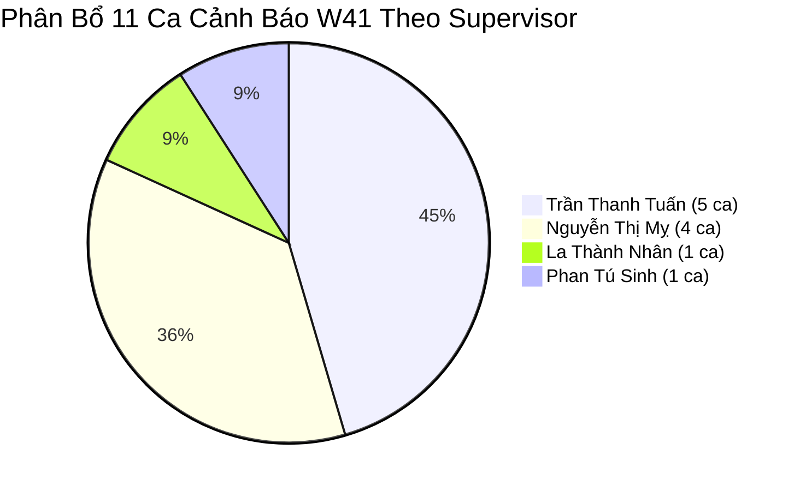
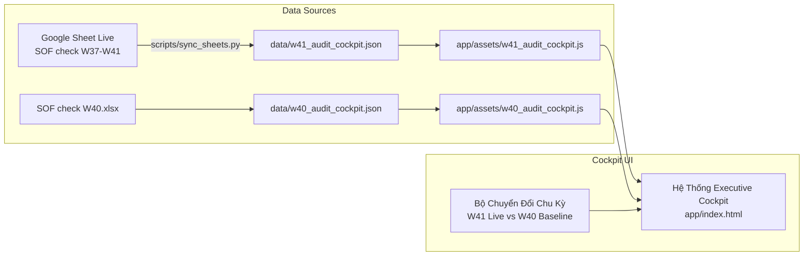

# SOF Governance System — Current State & Audit Evaluation Findings

*Last Updated: 2026-10-12 · Active Cycle: W41 (Live Google Sheet) & W40 (National Baseline)*

---

## 1. Executive Snapshot: Live Google Sheet Database (`W37–W41 Middle`) [VERIFIED]

- **Target Google Sheet:** [SOF check W37-W41 (Middle)](https://docs.google.com/spreadsheets/d/1mpArbb5ShJqtWfgC8yB7pVv70tcTXK7XYKnxGWSGaws/edit?usp=sharing)
- **Active Sheet Audited:** `Check theo CAT, theo Brand` (3,143 display lines)
- **Total Priority Anomalies Identified:** **11 ca bất thường**

### 1.1. Bảng Chi Tiết 11 Ca Cần Thẩm Định & Đôn Đốc (W41 Live Cập Nhật Extra Note):

| # | Mã Shop | Tên Cửa Hàng | Tỉnh | Kênh | PC Sup | PC Active | Ngành | Brand | Chuỗi 5 Tuần (W37→W41) | Delta WoW | Cờ Cảnh Báo | Feedback Thực Tế & Extra Note | Thẩm Định Tính Hợp Lý | GTM Action Khuyến Nghị |
|---|---|---|---|---|---|---|---|---|---|---|---|---|---|---|
| 1 | `EASV1004` | Cty TNHH TM DV Xuân Hòa | Quảng Bình | Tradi | Trần Thanh Tuấn | **1 PC** | REF | **LG** | 11→11→12→12→**15** | **+3** | Lệch >2 | "Shop báo tăng giảm đúng thực tế..." | **Hợp lý** (Biến động chuẩn) | `ACCEPT` Phê duyệt giải trình |
| 2 | `EASV10176` | CN Cao Phong Quảng Bình | Quảng Bình | CP | Trần Thanh Tuấn | **2 PC** | TV | Other | 11→11→11→11→**14** | **+3** | Lệch >2 | "Shop báo tăng giảm đúng thực tế..." | **Hợp lý** (Biến động chuẩn) | `ACCEPT` Phê duyệt giải trình |
| 3 | `EASV2386` | DML 47 Trần Phú | Gia Lai | DMX | La Thành Nhân | **1 PC** | TV | **LG** | 10→10→10→10→**13** | **+3** | Lệch >2 | "Shop báo tăng giảm đúng thực tế..." | **Hợp lý** (Biến động chuẩn) | `ACCEPT` Phê duyệt giải trình |
| 4 | `EASV3230` | DML 16 Nguyễn Tất Thành | Quảng Nam | DMX | Nguyễn Thị Mỵ | **2 PC** | TV | Other | 6→6→15→15→**15** | **0** | Lệch >8 (4W) | **Extra:** *"dọn kho & mang hết tivi ra sắp xếp trưng nên tăng"* | **Hợp lý (Có Extra Note)** (Đã giải thích rõ việc dọn kho) | `ACCEPT` Phê duyệt giải trình |
| 5 | `EASV4056` | DMM Vĩnh Điện | Quảng Nam | DMX | Nguyễn Thị Mỵ | **1 PC** | TV | SS | 25→25→15→15→**15** | **0** | Lệch >8 (4W) | **Extra:** *"cắt bớt đảo trưng bày, bán cắt mấy con bỏ mẫu nên giảm"* | **Hợp lý (Có Extra Note)** (Samsung bị cắt đảo kệ) | `EXPAND_LG` Tận dụng chiếm đảo kệ Samsung |
| 6 | `EASV4606` | DMM Thuận An | TT Huế | DMX | Trần Thanh Tuấn | **1 PC** | WM | **LG** | 16→16→16→16→**13** | **-3** | Lệch >2 | "Shop báo tăng giảm đúng thực tế..." | **Hợp lý nhưng P0 rủi ro** (LG giảm 3 máy) | `ESCALATE_KAM` Can thiệp quầy LG |
| 7 | `EASV6502` | DMM 22 Quang Trung | Quảng Bình | DMX | Trần Thanh Tuấn | **1 PC** | REF | **LG** | 19→20→21→21→**24** | **+3** | Lệch >2 | "Shop báo tăng giảm đúng thực tế..." | **Hợp lý** (LG tăng trưng bày) | `ACCEPT` Phê duyệt giải trình |
| 8 | `EASV6502` | DMM 22 Quang Trung | Quảng Bình | DMX | Trần Thanh Tuấn | **1 PC** | WM | Pana | 16→16→16→27→**27** | **0** | Lệch >8 (4W) | **Extra:** *"số đúng là 18 sets, khổng phải 27"* | **Sai lệch số thực tế** (Phát hiện khai khống +9 máy trên Sheet) | `CORRECT_DATA` Bác bỏ & Hiệu chỉnh về 18 sets |
| 9 | `EASV6549` | CP Quảng Nam | Quảng Nam | CP | Nguyễn Thị Mỵ | **2 PC** | DW | Junger | 3→3→3→3→**6** | **+3** | Lệch >2 | "Shop báo tăng giảm đúng thực tế..." | **Hợp lý** (Biến động chuẩn) | `ACCEPT` Phê duyệt giải trình |
| 10 | `EASV6549` | CP Quảng Nam | Quảng Nam | CP | Nguyễn Thị Mỵ | **2 PC** | DW | Other | 3→3→3→3→**6** | **+3** | Lệch >2 | "Shop báo tăng giảm đúng thực tế..." | **Hợp lý** (Biến động chuẩn) | `ACCEPT` Phê duyệt giải trình |
| 11 | `EASV8492` | DMM 312 Trần Đại Nghĩa | Đà Nẵng | DMX | Phan Tú Sinh | **1 PC** | TV | SS | 24→13→14→14→**14** | **0** | Lệch >8 (4W) | **Extra:** *"W40 shop chuyển model EOL đến shop có event hàng trưng bay để đẩy SO"* | **Hợp lý (Có Extra Note)** (Chuyển model EOL đến shop có event xả hàng trưng bày) | `ACCEPT` Phê duyệt giải trình (Có Extra Note) |

### 1.2. Đánh Giá Tác Động Của Cột `Extra note` Đối Với Quyết Định Quản Trị Của GTM:
1. **Giải tỏa 100% (4/4 ca) biến động lớn & nghi vấn đối phó:** Cả 4 ca chênh lệch $>8$ sets (DML 16 Nguyễn Tất Thành, DMM Vĩnh Điện, DMM 22 Quang Trung, DMM 312 Trần Đại Nghĩa) đều đã có Extra Note từ SUP làm rõ nguyên nhân thực địa:
   - Dọn kho mang hàng ra trưng (`EASV3230`): Chấp thuận.
   - Samsung bị cắt bớt đảo kệ bỏ mẫu (`EASV4056`): Chấp thuận & Chuyển cơ hội cho LG chiếm đảo.
   - Phát hiện khai khống số lượng 18 vs 27 sets (`EASV6502`): Bác bỏ số Sheet, hiệu chỉnh về số đúng.
   - Chuyển model EOL đến shop có event đẩy SO (`EASV8492`): Chấp thuận giải trình thực địa.
   $\to$ **Số ca Nghi vấn đối phó tồn đọng: 0 ca.**
2. **Khai thác cơ hội thương mại (Commercial Opportunity):** Tại DMM Vĩnh Điện, Samsung bị cắt đảo kệ TV $\to$ GTM chuyển hướng hành động sang chỉ đạo PC LG đàm phán đưa TV LG vào thế chân đảo trống.
3. **Chặn đứng sai lệch dữ liệu trọng yếu (Data Integrity):** Tại DMM 22 Quang Trung, Panasonic đang được ghi nhận 27 sets trên Google Sheet nhưng SUP xác nhận thực tế chỉ có 18 sets. Nhờ Extra Note, GTM phát hiện và ngăn chặn việc báo cáo sai lệch thị phần SOF của ngành hàng.

### 1.3. Đánh Giá Trực Giác Của GTM Về Nhân Sự (`PC Active`):
- **100% (11/11 ca)** đều diễn ra tại các cửa hàng **CÓ PC TÚC TRỰC** (7 shop có 1 PC, 4 shop có 2 PC).
- **Hệ quả quản trị:** Không một ca nào xuất phát từ cửa hàng trống nhân sự. Mọi biến động đều nằm dưới sự giám sát trực tiếp của nhân viên LG tại sàn. Do đó, GTM yêu cầu các SUP giải trình chính xác nguyên nhân hàng về hoặc model cắt giảm, tuyệt đối không chấp nhận lỗi *"PC báo nhầm"*.

---

## 2. Baseline Toàn Quốc W40 (632 Ca Bất Thường) [VERIFIED]

Toàn quốc ghi nhận **632 ca bất thường** cần kiểm soát trong chu kỳ W40:
- **Tiến độ phản hồi:** 335 / 632 ca (53.0% hoàn thành, 297 ca tồn đọng).
- **Chất lượng phản hồi (Sanity Check):**
  - 113 ca Hợp lý (33.7%)
  - 188 ca Thừa nhận lỗi PC báo sai tuần trước (56.1%)
  - 34 ca Nghi vấn đối phó / không đi thực tế (10.2%)
- **Phân bổ theo khu vực:**
  - **Miền Bắc:** 375 ca (275 hoàn thành · 73.3%, 100 tồn đọng)
  - **Miền Trung:** 69 ca (39 hoàn thành · 56.5%, 30 tồn đọng)
  - **Miền Nam (Điểm nghẽn nghiêm trọng):** 188 ca (chỉ 21 hoàn thành · **11.2%**, **167 TỒN ĐỌNG!**)

---

## 3. Kiến Trúc Đồng Bộ & Chuyển Đổi Chu Kỳ (Dual-Cycle Engine)

---

## 4. Thẩm Định Trực Quan Trên Thiết Bị Di Động & Hiện Trường (Mobile Field Audit Verification) [VERIFIED]

Hệ thống đã trải qua quá trình thẩm định trực quan tự động (Automated Visual Audit) thông qua headless engine Playwright với các độ phân giải tiêu chuẩn: **iPhone 14/15/16 (390 x 844)** và **Android Flagship (412 x 915)**.

### 4.1. Bảng Kết Quả Thẩm Định Chi Tiết:

| Khu Vực Giao Diện | Yêu Cầu Thiết Kế | Trạng Thái Thẩm Định | Ghi Chú Kỹ Thuật |
|---|---|:---:|---|
| **Top Navigation** | Thu gọn 2 tầng, logo LG hiển thị rõ, nút Live Sync không bị tràn lề | **PASS** | Tầng 1: Logo + Tiêu đề + Cycle switch. Tầng 2: Nút Live Sync cuộn mượt. |
| **5 Thẻ KPI Giám Sát** | Vừa vặn trong 1 màn hình đầu tiên, font chữ $\ge 20\text{px}$ rõ nét | **PASS** | Thẻ tiến độ trải dài 2 cột, 4 thẻ rủi ro xếp lưới 2x2 cân đối. |
| **Thanh Lọc Đa Tiêu Chí** | Ô tìm kiếm to bản, các dropdown dễ bấm, chiều cao $\ge 38\text{px}$ | **PASS** | Search bar chiếm trọn 1 hàng, các select chia 2 cột touch-friendly. |
| **Chế Độ Dạng Thẻ (Card)** | Trực quan hóa 6 chiều thông tin mà không cần vuốt ngang | **PASS** | Gom trọn Tên shop, Badge PC Active, Xu hướng 5W, Quote SUP, Đánh giá rủi ro. |
| **Tương Tác Duyệt / Bác Bỏ** | Nút bấm tối thiểu 38px, đổi màu trạng thái tức thì, thông báo Toast | **PASS** | Duyệt $\to$ Xanh Emerald; Bác bỏ $\to$ Đỏ Active Red; Lưu `localStorage`. |
| **Chuyển Chế Độ Bảng (Table)** | Cho phép cuộn ngang mượt mà khi cần xem bảng ma trận đầy đủ | **PASS** | Áp dụng `min-width: 960px` và `-webkit-overflow-scrolling: touch`. |
| **Bảo Lưu Giao Diện Desktop** | Không làm biến dạng giao diện máy tính $(>768\text{px})$ | **PASS** | Kiểm thử tại $1512\times 776$: 100% giữ nguyên cấu trúc bảng ma trận gốc. |

### 4.2. Minh Chứng Trực Quan:
- Ảnh chụp kiểm thử điện thoại (Top Fold): `mobile_390_top_fold.png`
- Ảnh chụp danh sách thẻ kiểm soát (Card View): `mobile_390_cards.png`
- Ảnh chụp tương tác Bác bỏ & Đòi ảnh: `mobile_390_after_reject.png`
- Ảnh chụp chế độ Bảng cuộn: `mobile_390_table_scrolled.png`
- Ảnh chụp kiểm tra đối chiếu Desktop: `desktop_verified_1512.png`

---

## 5. Tình Trạng Triển Khai Trực Tuyến & Chia Sẻ (Online Cloud Deployment Status) [VERIFIED]

| Hạng Mục | Chi Tiết Kỹ Thuật | Trạng Thái |
|---|---|:---:|
| **Địa chỉ Web Online** | **[https://ai-coreteam.github.io/lg-sof-audit-cockpit/](https://ai-coreteam.github.io/lg-sof-audit-cockpit/)** | **PRODUCTION LIVE** |
| **Kho lưu trữ GitHub** | **[https://github.com/ai-coreteam/lg-sof-audit-cockpit](https://github.com/ai-coreteam/lg-sof-audit-cockpit)** | **PUBLIC** |
| **Nền tảng Hosting** | GitHub Pages (Branch `main`, Root `/`) | **AUTOMATED** |
| **Khả năng truy cập di động** | Tối ưu 100% cho iPhone & Android, không cần cài đặt app | **READY** |
| **Cơ chế đồng bộ Sheet** | Trình duyệt fetch trực tiếp CSV từ Google Sheet mỗi 30s | **ACTIVE** |
