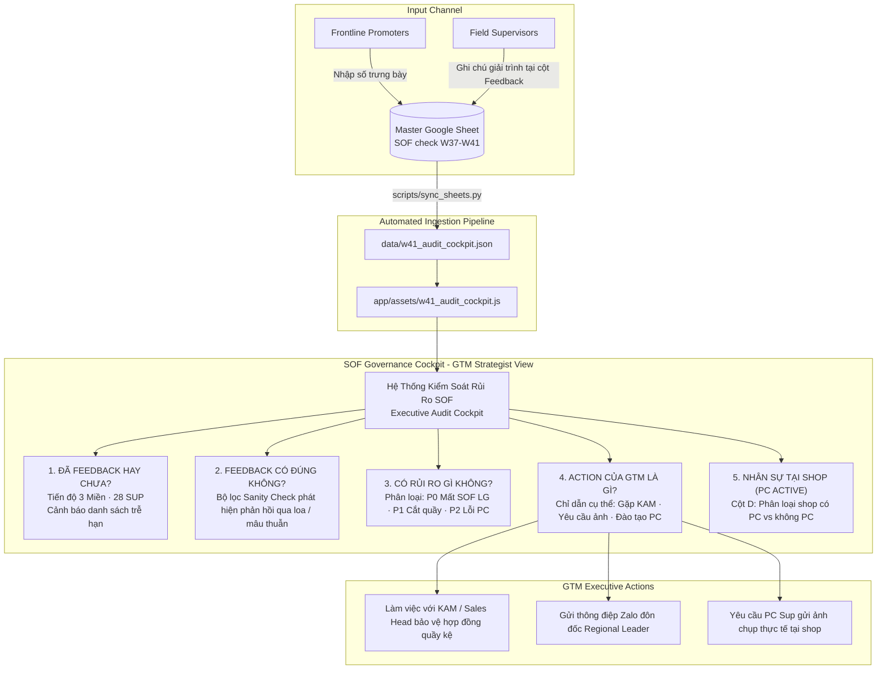
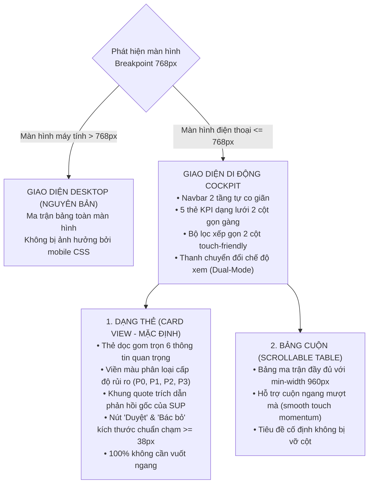

# SOF Monitoring & Governance Cockpit (Hệ Thống Kiểm Soát & Quản Trị Rủi Ro SOF)

> **🌐 Web Online (Xem Trực Tuyến):** **[https://ai-coreteam.github.io/lg-sof-audit-cockpit/](https://ai-coreteam.github.io/lg-sof-audit-cockpit/)**  
> **📦 GitHub Repository:** **[https://github.com/ai-coreteam/lg-sof-audit-cockpit](https://github.com/ai-coreteam/lg-sof-audit-cockpit)**  
> **📖 Hướng dẫn triển khai & chia sẻ:** Xem chi tiết tại [docs/DEPLOYMENT_GUIDE.md](file:///Users/macbook/Documents/antigravity/AI%20study/LG%20other/SOF%20monitoring/docs/DEPLOYMENT_GUIDE.md)

## 1. Bản Chất Hệ Thống & Vai Trò Người Dùng (Executive Persona)

Hệ thống **SOF Monitoring & Governance Cockpit** được xây dựng dành riêng cho **GTM Channel Development Strategist / Head of Retail Marketing (User)** tại LG Electronics để:
1. **Kiểm soát tiến độ:** Giám sát 28 PC Supervisors và 3 Regional Leaders đã hoàn thành giải trình các ca bất thường trên Google Sheet hay chưa.
2. **Kiểm tra tính hợp lý (Sanity Check):** Tự động phát hiện các phản hồi bất thường, mâu thuẫn số liệu (ví dụ: data rơi về 0 nhưng giải trình "tăng giảm đúng thực tế", hoặc copy-paste đối phó).
3. **Đánh giá rủi ro thương mại (Risk Assessment):** Phát hiện nguy cơ bị đại lý thu hẹp quầy kệ, đối thủ chiếm bục kệ LG, hoặc tỷ lệ PC báo sai cao đột biến.
4. **Đề xuất hành động tức thì cho GTM (Action Playbook):** Chỉ dẫn rõ GTM cần làm gì tiếp theo (Làm việc với KAM, yêu cầu chụp ảnh quầy, đôn đốc kỷ luật PC, hay duyệt dữ liệu chốt tuần).
5. **Tích hợp Google Sheet trực tiếp:** Tự động lấy dữ liệu từ Google Sheet vận hành trực tiếp, nhận diện cột `PC active` (Cột D) để đánh giá tính nghiêm trọng của báo cáo.



---

## 2. Bốn Trụ Cột Giám Sát Cốt Lõi (4 Core Governance Pillars)

| Trụ Cột | Câu Hỏi Của Quản Lý | Cơ Chế Xử Lý Của Hệ Thống | Hiện Trạng Snapshot |
|---|---|---|---|
| **1. Tiến độ phản hồi** | *Các case đã feedback hay chưa?* | Bóc tách real-time: `ĐÃ FEEDBACK` vs `CHƯA FEEDBACK` theo từng Miền và từng SUP. | **W41: 11/11 ca đã phản hồi (100%)** · **W40: 335/632 ca đã làm (53%)** |
| **2. Tính hợp lý** | *Feedback của họ có đúng hay không?* | Chạy thuật toán đối chiếu logic: So sánh độ lệch WoW/4W với nội dung giải trình và **Extra note**. Tự động chuyển toàn bộ ca có Extra Note ra khỏi mục nghi vấn (Nguyên tắc MECE). | **W41: 4 có Extra Note (3 hợp lý · 1 sai lệch số) · 0 nghi vấn (100% ca lệch lớn đã giải trình)** |
| **3. Đánh giá rủi ro** | *Feedback có rủi ro gì không?* | Phân tầng rủi ro: P0 Mất SOF LG, P1 Cắt giảm quầy kệ thương mại, P2 Lỗi vận hành & lệch số, P3 Bình thường. | **W41: 1 ca P0 LG (-3) · 1 ca lệch số 18 vs 27 · 0 ca đối phó tồn đọng** |
| **4. Hành động của GTM** | *Action của tôi sau feedback là gì?* | Gợi ý kịch bản hành động chuẩn hóa tương ứng với từng loại rủi ro (Action Playbook). | **W41: Phê duyệt dọn kho & EOL · Chiếm đảo Samsung · Sửa số Pana 18 vs 27** |

---

## 3. Kiến Trúc Dữ Liệu & Quy Trình Đồng Bộ Live

### 3.1. Nguồn Dữ Liệu Google Sheet:
- **URL Google Sheet:** [SOF check W37-W41 (Middle)](https://docs.google.com/spreadsheets/d/1mpArbb5ShJqtWfgC8yB7pVv70tcTXK7XYKnxGWSGaws/edit?usp=sharing)
- **Tab dữ liệu chính:** `Check theo CAT, theo Brand` (GID: `1357809752`).
- **Cột nhân sự chèn tại Cột D:** `PC active` (Số lượng promoter đang làm việc tại điểm bán).
- **Cột ghi chú chèn tại Cột R:** `Extra note` (Ghi chú nghiệp vụ thực địa bổ sung giải thích biến động sâu và đính chính số lượng).
- **Chu kỳ hiển thị:** 5 tuần liên tiếp (`W37 → W41`).

### 3.2. Cơ Chế Đồng Bộ Real-Time (Zero-Backend Client Engine):
Hệ thống hỗ trợ đồng bộ tự động 2 chiều:
1. **Trực tiếp từ Trình duyệt (Browser Live Sync):**
   - Trình duyệt tự động fetch endpoint CSV của Google Sheet (`export?format=csv&gid=1357809752`) qua CORS mở.
   - **Tần suất tự động:** Mỗi 30 giây (`setInterval`) hoặc **ngay khi người dùng chuyển tab quay lại web** (`window.focus`).
   - **Độc lập với bộ lọc:** Không bị ảnh hưởng nếu ai đó đang bật Filter trên Google Sheet.
   - Đèn xanh nhấp nháy trên Top Bar hiển thị thời gian đồng bộ thành công mới nhất (`Live: HH:MM:SS`).

2. **Lệnh Đồng Bộ Dự Phòng Từ Terminal (CLI Tool):**
```bash
python3 scripts/sync_sheets.py
```
Script sẽ tự động:
1. Tải toàn bộ 3.145 dòng từ Google Sheet CSV / XLSX.
2. Trích xuất các dòng có cờ bất thường và chạy thuật toán Sanity Check / Risk Evaluation.
3. Cập nhật `data/w41_audit_cockpit.json` và `app/assets/w41_audit_cockpit.js`.

---

## 4. Kiến Trúc Tương Thích Di Động (Phone UI & Responsive Dual-Mode Engine)

Hệ thống được thiết kế theo tiêu chuẩn công thái học di động (Mobile Ergonomics) nghiêm ngặt, cho phép GTM Strategist, Regional Leader và Field Supervisor kiểm soát trực tiếp trên smartphone khi đi thực địa tại cửa hàng:



### 4.1. Đặc Điểm Thiết Kế Di Động Nổi Bật:
1. **Cô Lập Tuyệt Đối Giao Diện Máy Tính (Desktop Isolation):**
   - Bộ chọn `@media (max-width: 768px)` chỉ kích hoạt trên thiết bị di động.
   - Khi xem trên máy tính bàn hoặc laptop, toàn bộ các khối Mobile View Toggle và Mobile Cards đều bị ẩn hoàn toàn (`display: none !important`), giữ nguyên 100% bố cục và tỷ lệ bảng ma trận đã được phê duyệt.
2. **Chế Độ Kép Thông Minh (Dual-Mode Selector):**
   - **`Dạng Thẻ` (Executive Card View - Khuyến nghị cho Phone):** Tối ưu cho thao tác một tay bằng ngón cái. Mỗi ca cảnh báo là một thẻ độc lập hiển thị đầy đủ Tên shop, Mã shop, Nhân sự `PC Active`, Ngành hàng, Xu hướng 5 tuần, Quote giải trình gốc, Đánh giá Sanity Check và 2 nút quyết định `Duyệt` / `Bác bỏ`.
   - **`Bảng Cuộn` (Scrollable Table Mode):** Dành cho người dùng quen phong cách bảng tính Excel, cho phép lướt ngang toàn bộ các cột thông tin mà không bị co cụm font chữ.
3. **Chuẩn Chạm Công Thái Học (Touch Ergonomics):**
   - Tất cả các nút tương tác (`Duyệt`, `Bác bỏ / Đòi ảnh`, thanh lọc, nút đổi chu kỳ) đều đạt chiều cao tối thiểu $\ge 38\text{px}$, khoảng cách chống bấm nhầm $\ge 8\text{px}$ và có hiệu ứng nhấn nhả (`active scale 0.98`).
   - Tích hợp thông báo Toast nổi ở đáy màn hình khi lưu quyết định.
4. **Đồng Bộ Dữ Liệu Hai Chiều (State Persistence):**
   - Trạng thái quyết định của GTM (`APPROVED` / `REJECTED`) được lưu vào `localStorage` theo chu kỳ và đồng bộ tự động tức thì trên cả chế độ Thẻ lẫn chế độ Bảng.

---

## 5. Tài Liệu Kế Thừa Chi Tiết

- [BUSINESS_RULES.md](file:///Users/macbook/Documents/antigravity/AI%20study/LG%20other/SOF%20monitoring/docs/BUSINESS_RULES.md) — Thuật toán 3 cờ cảnh báo, ý nghĩa chỉ số `PC active`, Sanity Check Matrix và GTM Action Playbook.
- [CURRENT_STATE.md](file:///Users/macbook/Documents/antigravity/AI%20study/LG%20other/SOF%20monitoring/docs/CURRENT_STATE.md) — Báo cáo chi tiết 11 ca W41 Miền Trung, baseline W40 toàn quốc (632 ca) và kết quả thẩm định Mobile UI.
- [DATA_DICTIONARY.md](file:///Users/macbook/Documents/antigravity/AI%20study/LG%20other/SOF%20monitoring/docs/DATA_DICTIONARY.md) — Từ điển dữ liệu chuẩn của Live Google Sheet (A–Q), file Excel W40 và LocalStorage State Schema.
- [DEPLOYMENT_GUIDE.md](file:///Users/macbook/Documents/antigravity/AI%20study/LG%20other/SOF%20monitoring/docs/DEPLOYMENT_GUIDE.md) — Cẩm nang triển khai Web Online, kiến trúc Serverless GitHub Pages và quy trình đồng bộ.
